## TP 4 : Hibernate-Inheritance
Vue d'ensemble de la structure du projet dans l'IDE. Elle illustre l'organisation des packages pour la gestion du mapping de l'héritage JPA en trois stratégies distinctes : joined (tables jointes), singletable (table unique) et tableperclass (une table par classe concrète).\
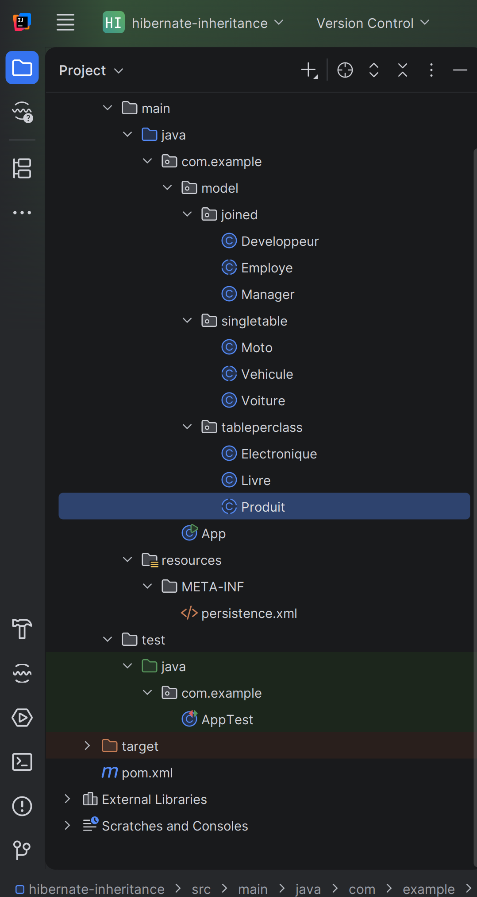
Définition de l'entité Developpeur située dans le package joined. Elle hérite de la classe abstraite Employe et ajoute un attribut spécifique langage. En base de données, cette entité possède sa propre table reliée à celle de l'employé par une clé étrangère.
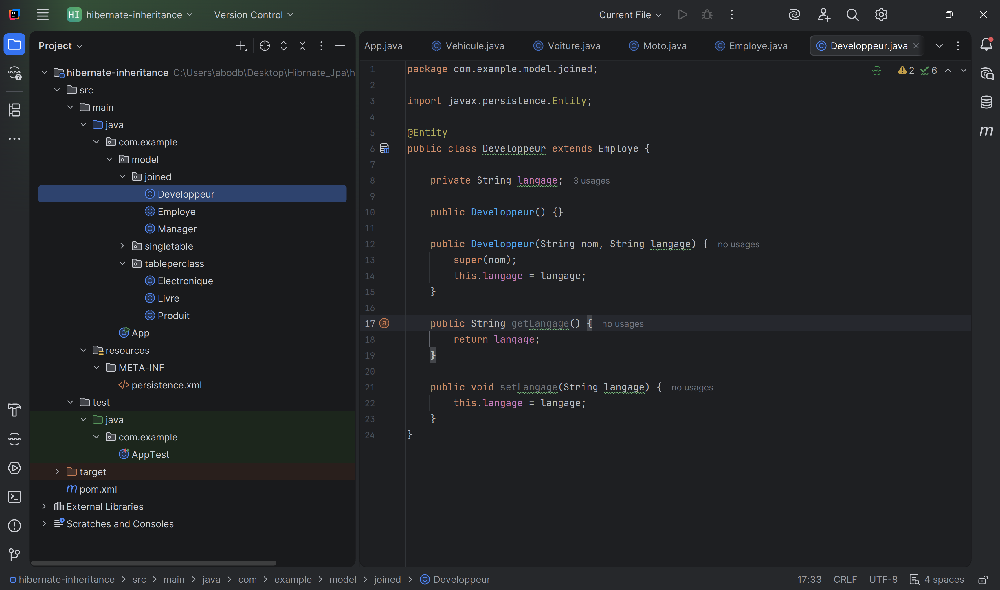
Définition de la classe mère abstraite Employe pour la stratégie JOINED. Elle regroupe les identifiants et les attributs communs (comme id et nom) qui seront stockés dans la table parente principale.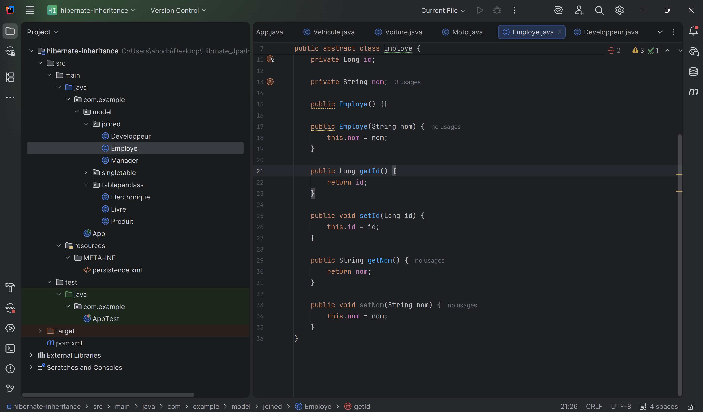
Définition de l'entité Manager héritant de Employe. Elle contient le champ spécifique nombreEquipes. Sa propre table contiendra cet attribut spécifique lié à l'ID de la table parente.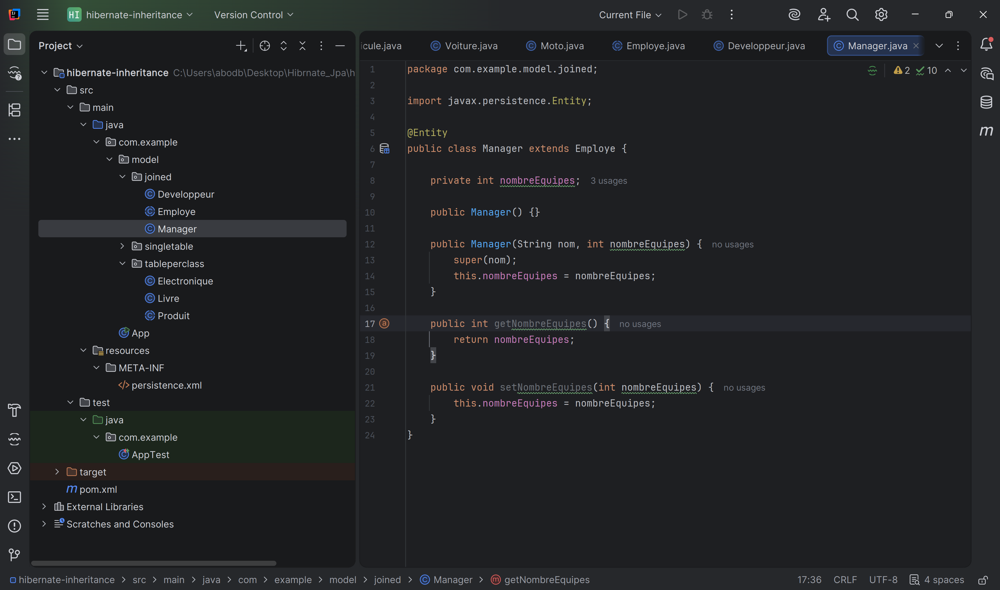
Classe fille Moto étendant Vehicule dans la stratégie à table unique. L'annotation @DiscriminatorValue("MOTO") spécifie la valeur inscrite dans la colonne de discrimination pour identifier ce type d'enregistrement.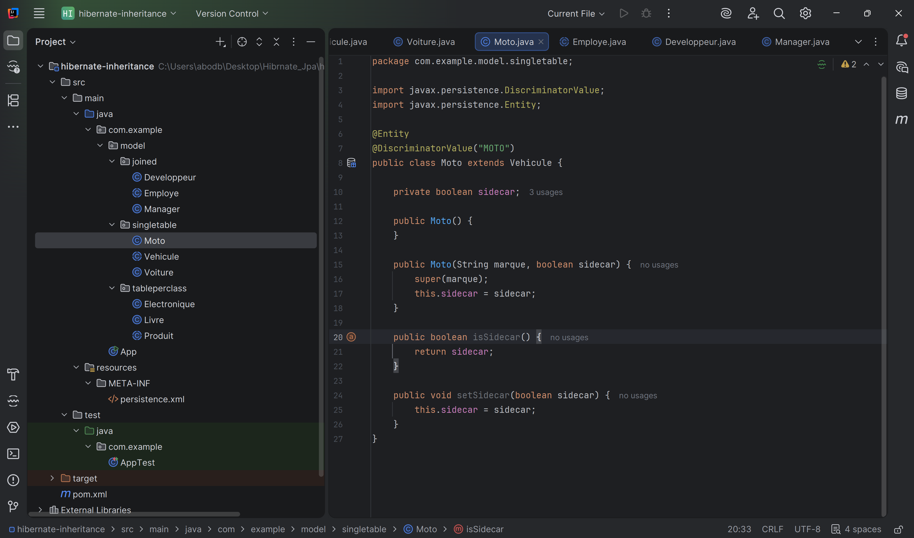
Configuration de la classe parente Vehicule avec @Inheritance(strategy = InheritanceType.SINGLE_TABLE). L'annotation @DiscriminatorColumn définit la colonne de type texte (vehicule_type) utilisée pour distinguer les sous-classes (Moto, Voiture) dans une seule et même table SQL.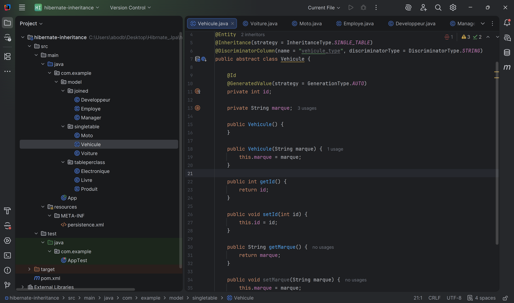
Classe fille Voiture étendant Vehicule, avec la valeur de discriminateur "VOITURE" et l'attribut propre nombrePortes. Toutes les instances de Voiture et Moto partagent la même table SQL.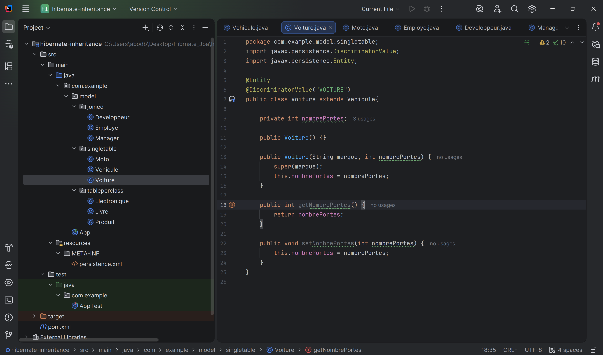
Entité fille Electronique représentant un produit avec un attribut garantie. Avec la stratégie TABLE_PER_CLASS, une table SQL complète est générée spécifiquement pour cette classe concrète, incluant aussi bien ses champs propres que ceux hérités de la classe parente.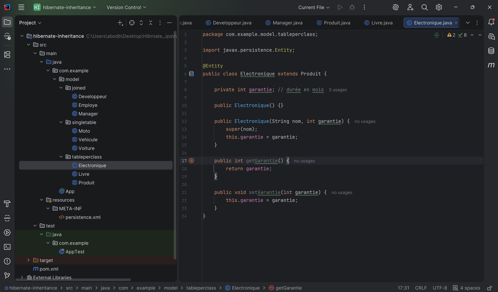
Entité fille Livre héritant de Produit, avec son attribut propre auteur. Sa table SQL dédiée contiendra toutes ses colonnes métier ainsi que l'identifiant et le nom hérités.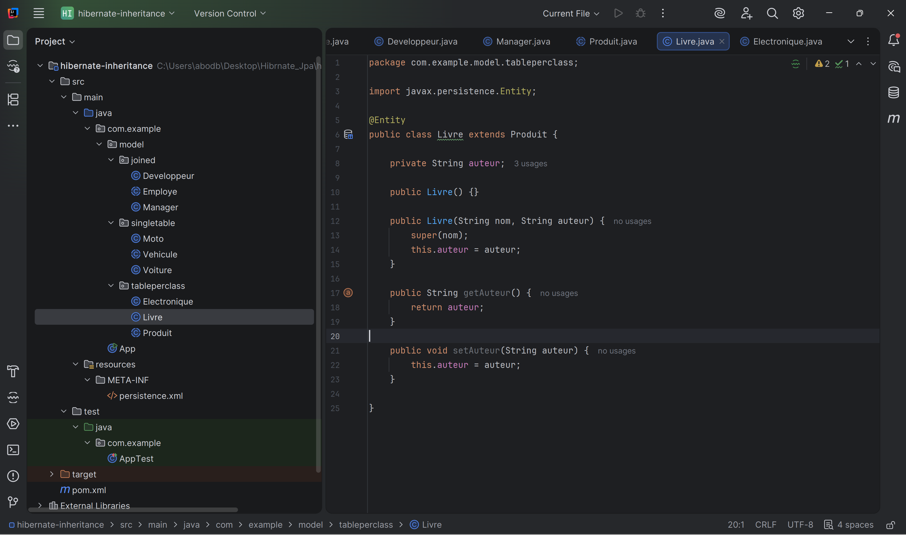
Classe mère abstraite Produit annotée avec @Inheritance(strategy = InheritanceType.TABLE_PER_CLASS). Elle sert de modèle de base et définit les propriétés communes (id, nom) sans générer de table propre car elle est abstraite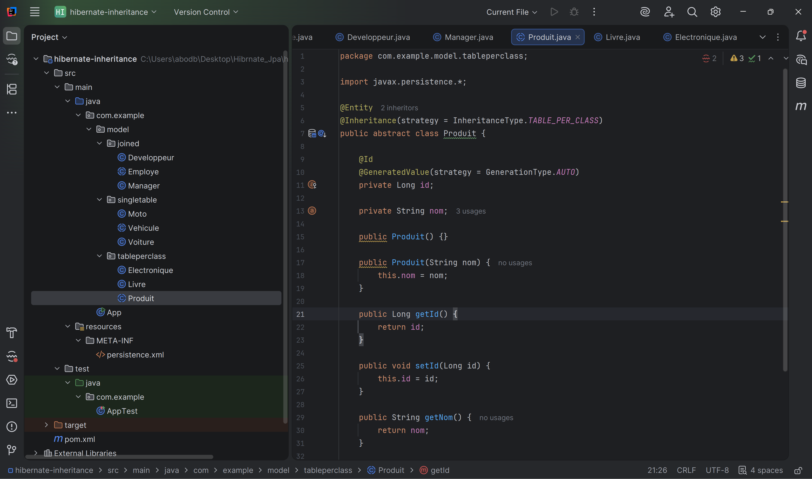
Implémentation du programme principal App.java effectuant la persistance d'instances pour chaque stratégie d'héritage (SINGLE_TABLE, JOINED, et TABLE_PER_CLASS) dans une transaction unique.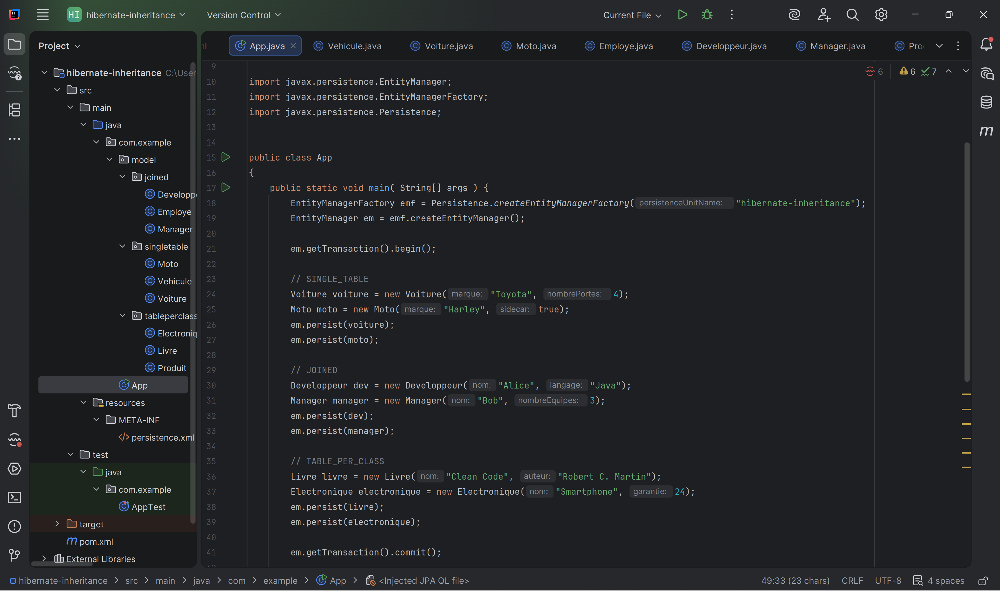
Exécution de requêtes JPQL polymorphiques sur les classes mères pour récupérer et afficher la liste complète des véhicules, employés et produits enregistrés.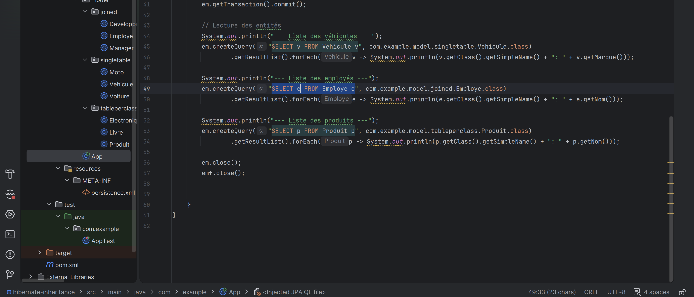
Déclaration de toutes les classes entités de chaque stratégie d'héritage et configuration de la base de données H2 en mode create-drop.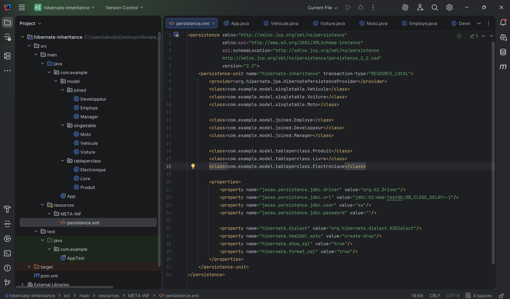
Intégration des dépendances Maven requises, incluant l'API JPA, le moteur d'implémentation Hibernate et le connecteur de la base de données H2.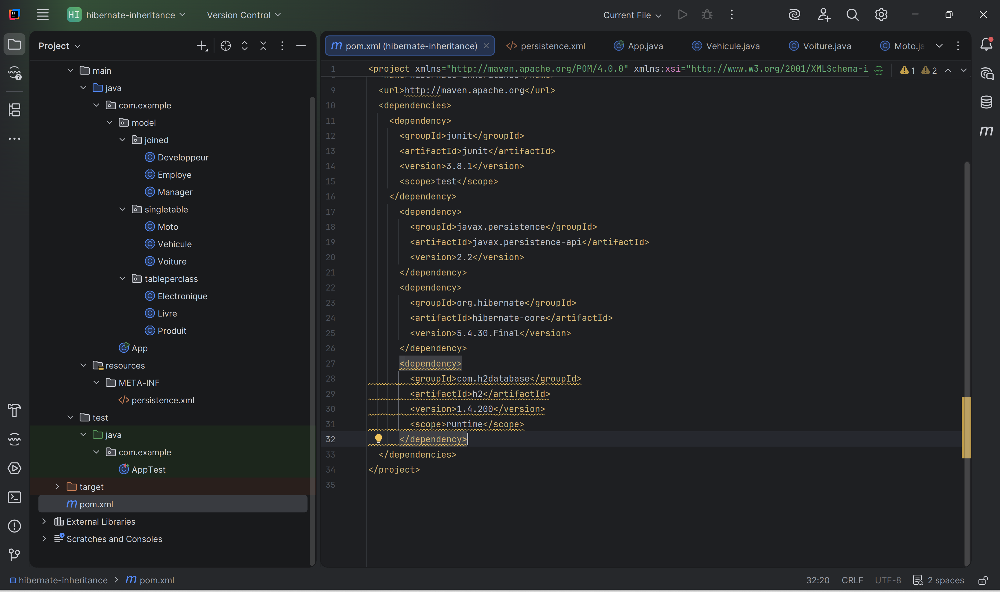
Affichage dans la console des requêtes SQL polymorphiques générées par Hibernate (utilisation de LEFT OUTER JOIN et de requêtes unifiées) lors de la récupération des entités en base de données.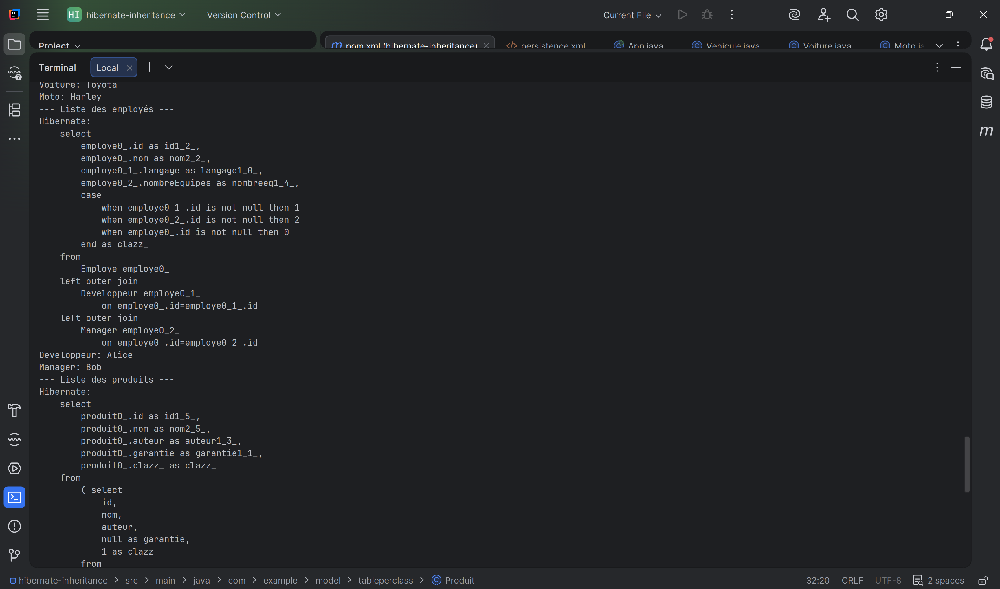